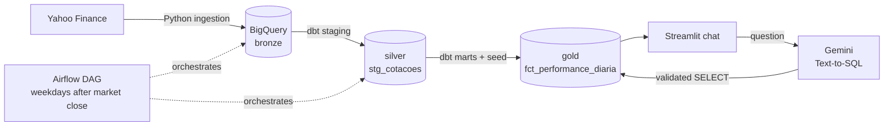

# B3 Market Data Pipeline with a Text-to-SQL Assistant

End-to-end data platform for Brazilian stocks (RENT3, PETR4, VALE3, ITUB4, WEGE3): daily ingestion from Yahoo Finance, a medallion model in BigQuery built with dbt, orchestration with Airflow, and a chat interface where you ask questions in plain language and get answers computed from the warehouse.

## Architecture



| Layer | What it does |
|---|---|
| **Ingestion** | Pulls one year of daily OHLCV data per ticker with `yfinance` and loads it into `bronze.historico_acoes`. |
| **Silver** | `stg_cotacoes`: typed columns (`NUMERIC` for prices), one row per ticker and trading day, partitioned by date and clustered by ticker. |
| **Gold** | `fct_performance_diaria`: daily return, intraday change and 7-day moving average, enriched with company name and sector from a dbt seed. Partitioned by date, clustered by sector and ticker. |
| **Quality** | `dbt build` runs seeds, models and tests together: `not_null` checks plus a singular test that fails if any ticker has more than one row per trading day. |
| **Orchestration** | Airflow DAG (ingestion → `dbt build`) scheduled on weekdays after the B3 close, running on Docker with Postgres as the metadata database. |
| **Consumption** | Streamlit chat backed by Gemini: the question becomes SQL, the SQL runs on BigQuery, and the result comes back as a short answer, with the executed query available for inspection. |

## Design decisions

**Direct prompting instead of an autonomous SQL agent.** The first version used a LangChain SQL agent that explored the schema on its own. On the free tier it kept hitting API rate limits, cost several calls per question and produced inconsistent answers. Replacing it with a single prompt that carries a curated schema (column types, sample values for sectors and tickers) cut the number of LLM calls per question to two and made results far more consistent.

**Guardrails on generated SQL.** The model's output is treated as untrusted input. Before execution, the app only accepts a single `SELECT`/`WITH` statement, rejects any DDL or DML keyword, and runs the query with `maximum_bytes_billed` set. It can also use a separate read-only service account (`BQ_READONLY_CREDENTIALS`), so the chat never shares credentials with the dbt jobs that write to the warehouse.

**Idempotent loads.** Each ingestion run fetches the full one-year window, so the bronze table is replaced on every run, and the staging model deduplicates by ticker and date as a second safeguard. Running the DAG twice produces the same gold table.

**Built for the BigQuery sandbox.** The free tier does not allow DML, so models are materialized as partitioned and clustered tables instead of incremental merges. Partitioning by date and clustering by sector and ticker keeps the bytes scanned by each chat query small.

**Column descriptions reach the warehouse.** `persist_docs` writes the descriptions from `schema.yml` into BigQuery, so the metadata the LLM relies on lives next to the data.

## Project structure

```text
├── airflow/dags/            # Airflow DAG: ingestion → dbt build
├── invest_analytics/        # dbt project
│   ├── models/staging/      # silver layer
│   ├── models/marts/        # gold layer
│   ├── seeds/               # ticker → company and sector mapping
│   └── tests/               # singular data tests
├── src/ingestion/           # Yahoo Finance extraction
├── src/consumption/         # Streamlit + Gemini chat
├── Dockerfile               # Airflow image with dbt and AI libraries
└── docker-compose.yaml      # Airflow webserver, scheduler and Postgres
```

## Running locally

**Requirements:** Docker, a GCP project with BigQuery enabled, a service account key and a Gemini API key.

1. Save the service account key as `credentials/gcp_key.json` (the folder is git-ignored).
2. Export your Gemini key: `export GOOGLE_API_KEY=...`
3. Start the stack:
   ```bash
   docker-compose up -d --build
   ```
4. Open Airflow at `http://localhost:8080` and trigger `pipeline_wealth_tech`, or run dbt directly:
   ```bash
   docker exec -it airflow_scheduler bash -c "cd invest_analytics && dbt build --profiles-dir ."
   ```
5. Start the chat at `http://localhost:8501`:
   ```bash
   docker exec -it airflow_scheduler streamlit run /opt/airflow/src/consumption/app_wealth_chat.py \
     --server.port=8501 --server.address=0.0.0.0
   ```

Optional environment variables for the chat: `BQ_READONLY_CREDENTIALS` (path to a read-only service account key) and `MAX_BYTES_BILLED` (default: 1 GB per query).

## Example questions

- "What was Localiza's average closing price in the last 30 days?"
- "Which stock had the highest daily return last week?"
- "Compare the 7-day moving average of VALE3 and PETR4 this month."

## Next steps

- Evaluation set of questions with expected answers to measure Text-to-SQL accuracy over time.
- Incremental models once the project moves off the sandbox.
- Dedicated container for the chat instead of running it inside the scheduler.

---

Built by [Guilherme Caldas](https://www.linkedin.com/in/guilhermebcaldas/). Originally developed as the applied project for my MBA in AI, Data Science and Big Data at Ibmec; the full technical report (in Portuguese) is in [`relatorio.md`](relatorio.md).
